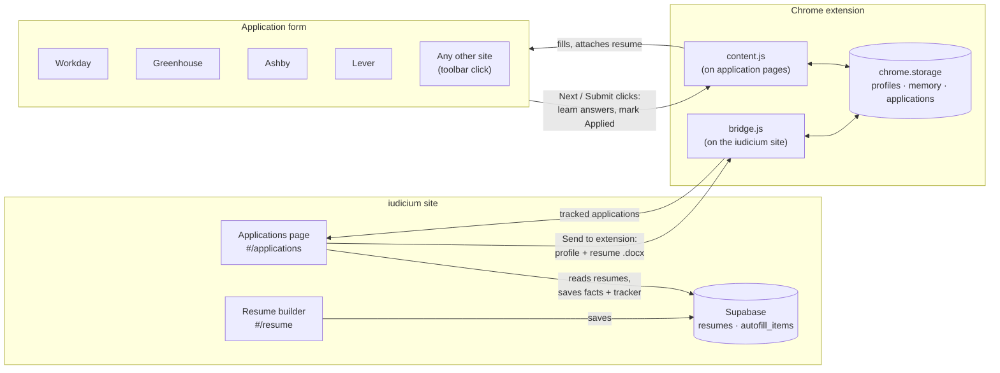
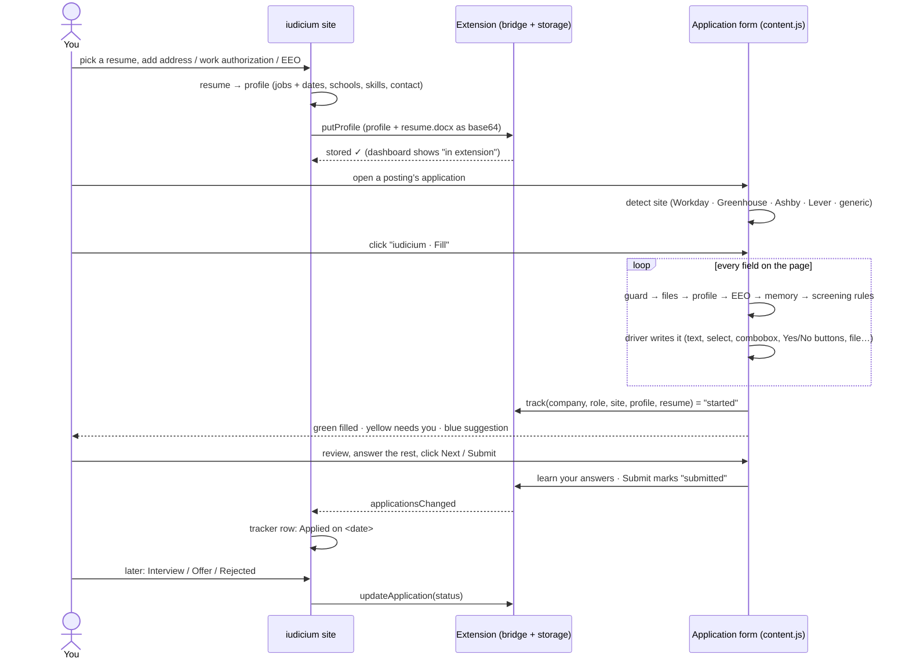
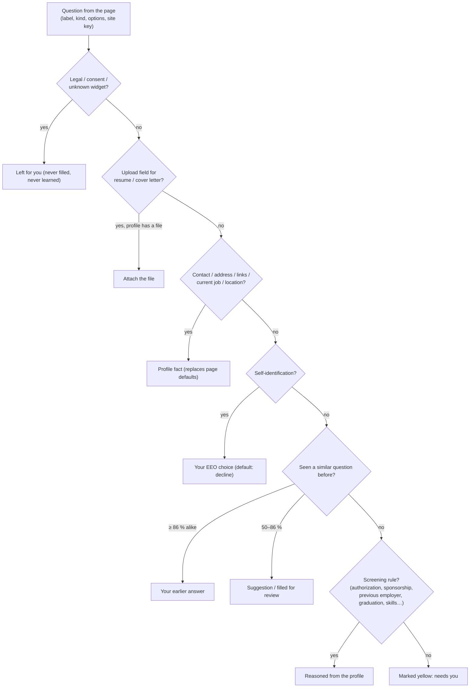

# Autofill flow

How a resume in the iudicium site turns into filled applications and a
tracker entry. (GitHub renders these diagrams.)

## The big picture

## One application, step by step

## What answers a field

